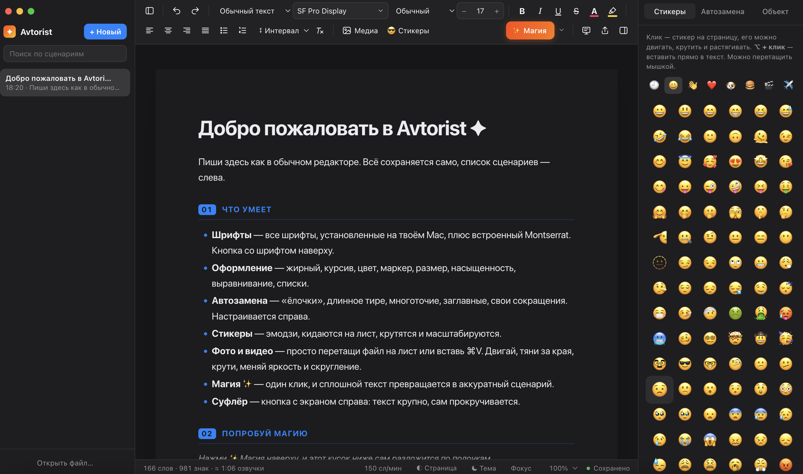
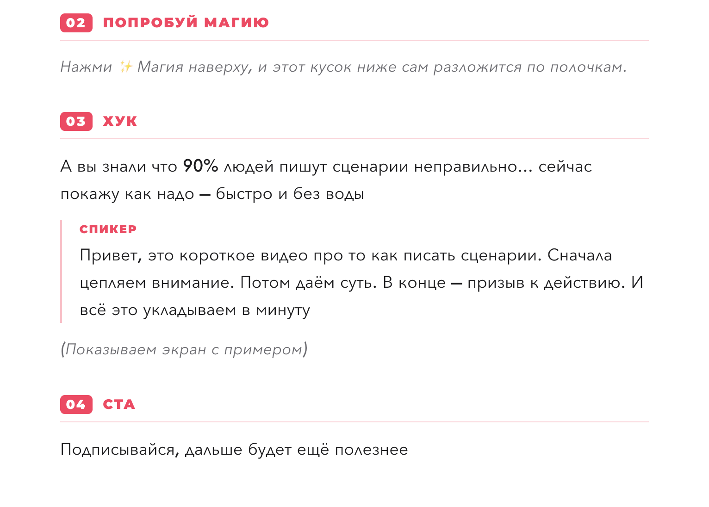
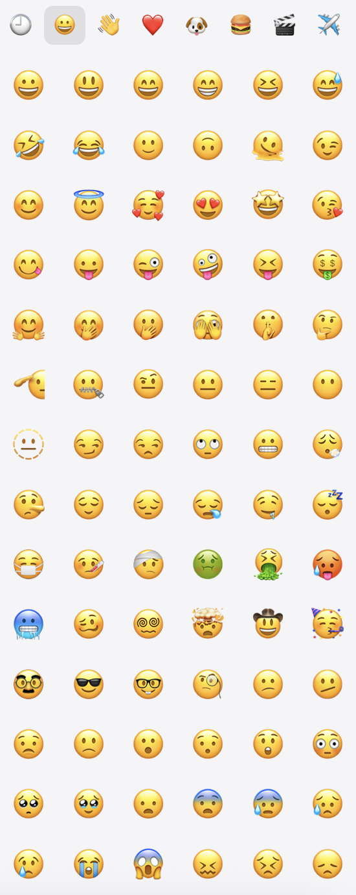

<p align="center"></p>

<h1 align="center">Avtorist</h1>
<p align="center"><b>Бесплатный офлайн-редактор сценариев для macOS и Windows</b><br>
Без рекламы · без регистрации · без интернета · без сбора данных</p>

<p align="center"></p>

## Что это

«Avtorist» — простой и быстрый редактор для сценариев роликов, подкастов и выступлений.
Пишешь сплошным текстом, нажимаешь ✨ **Магия**, и текст раскладывается на сцены, реплики и ремарки.
Всё хранится только на твоём компьютере.

## Возможности

- **Форматирование:** жирный, курсив, подчёркивание, цвет, маркер, размер, насыщенность, выравнивание, списки, интервалы.
- **Стили абзацев для сценария:** сцена, реплика спикера, ремарка, цитата, заголовки.
- **Все шрифты твоего компьютера** плюс встроенный Montserrat.
- **Автозамена при наборе:** «ёлочки», длинное тире, многоточие, заглавная буква в начале предложения, свои сокращения.
- **Стикеры-эмодзи:** их можно двигать, вращать и масштабировать на листе.
- **Фото и видео свободным слоем, как в графическом редакторе:** перетаскивание, масштаб, поворот, обрезка рамкой, яркость, контраст, скругление, тень, слои.
- **✨ Магия:** оформляет весь текст в один клик, в одном из четырёх стилей.
- **Хронометраж:** сколько времени займёт озвучка текста.
- **Суфлёр:** крупный текст с автопрокруткой и зеркальным режимом.
- **Экспорт:** PDF, Word (.doc), .txt, файл проекта `.scenario` со всеми медиа.
- **Автосохранение и защита от потери текста при сбое.**
- Светлая и тёмная тема, режим фокуса, поиск по сценариям.

<table><tr><td width="72%"><br><sub>После ✨ Магии: сцены, реплика спикера, ремарка</sub></td>
<td width="28%"><br><sub>Стикеры-эмодзи</sub></td></tr></table>

## Системные требования

| | macOS | Windows |
|---|---|---|
| Версия | 13 Ventura и новее | 10 и 11, 64-бит |
| Процессор | Apple Silicon (M1–M4…) или Intel | x64 (Intel / AMD) |
| Место | ~400 МБ | ~400 МБ |

## Скачать

Последняя версия: **[Releases → Avtorist 1.1.0](https://github.com/N-CUT/Avtorist/releases/latest)**

| Компьютер | Файл |
|---|---|
| Mac на Apple Silicon (M1, M2, M3, M4…) | `Avtorist-1.1.0-macOS-AppleSilicon.dmg` |
| Mac на Intel | `Avtorist-1.1.0-macOS-Intel.dmg` |
| Windows 10 / 11 | `Avtorist-1.1.0-Windows-x64.zip` |

Не знаешь, какой у тебя Mac? Меню  → «Об этом Mac». В строке «Чип» указано Apple M…, а если там «Процессор Intel», бери версию для Intel.

## Установка на Mac

> **Скачивай только со страницы Releases на GitHub через браузер** (Safari, Chrome). Если файл переслали через Telegram или другой мессенджер из App Store, macOS может вообще не дать его открыть («Не удаётся открыть программу»): она так обращается с файлами, сохранёнными «песочными» приложениями. Тогда просто скачай DMG заново с GitHub.

1. Скачай `.dmg` для своего Mac и открой его.
2. Перетащи «Avtorist» в папку «Программы» (Applications).
3. Открой «Avtorist» из Launchpad или папки «Программы».

**При первом запуске** macOS может сказать, что не может проверить разработчика. Так macOS ведёт себя со всеми приложениями без платной подписи Apple (подробнее в разделе «Безопасность»). Что делать:

- **macOS 15 Sequoia и новее:** нажми «Готово», открой  → «Системные настройки» → «Конфиденциальность и безопасность», прокрути вниз и нажми **«Всё равно открыть»** напротив «Avtorist». Подтверди паролем.
- **macOS 13–14:** нажми на «Avtorist» в «Программах» правой кнопкой → «Открыть» → «Открыть».

Это нужно сделать только один раз.

## Установка на Windows

1. Скачай `Avtorist-1.1.0-Windows-x64.zip`, нажми на нём правой кнопкой → **«Извлечь всё…»** и распакуй, например, в «Документы». Получится папка «Avtorist».
2. Открой папку и запусти **`Avtorist.exe`**.
3. Если Windows покажет синее окно «Система Windows защитила ваш компьютер», нажми **«Подробнее»** → **«Выполнить в любом случае»**. Так Windows встречает все приложения без платной цифровой подписи. Это нужно один раз.
4. Чтобы запускать удобно: правый клик по `Avtorist.exe` → «Закрепить на панели задач» (или «Показать дополнительные параметры» → «Отправить» → «Рабочий стол (создать ярлык)»).

Подробная инструкция для обеих систем: [INSTALL.md](INSTALL.md)

## Удаление на Mac

1. Закрой «Avtorist» (⌘Q).
2. Перетащи «Avtorist» из «Программ» в Корзину.
3. Если хочешь удалить и все свои сценарии, удали папку `~/Library/Application Support/Avtorist`. В Finder: «Переход» → «Переход к папке…» → вставь путь. **Внимание:** вместе с ней удалятся все сценарии. Сначала сохрани нужные через «Экспорт → Все сценарии одним файлом».

Больше никаких файлов приложение не создаёт.

## Удаление на Windows

1. Закрой «Avtorist».
2. Удали папку «Avtorist» (ту, куда распаковывал архив).
3. Если хочешь удалить и все сценарии, удали папку `%APPDATA%\Avtorist` (вставь этот путь в адресную строку Проводника). **Внимание:** вместе с ней удалятся все сценарии. Сначала сохрани нужные через «Экспорт → Все сценарии одним файлом».

## Конфиденциальность

- Приложение **не подключается к интернету**. Это закреплено в коде на уровне сетевого стека, а не только обещано.
- Не собирает и не отправляет никакие данные: ни телеметрию, ни аналитику, ни отчёты о сбоях, ни идентификаторы.
- Не требует аккаунта и регистрации.
- Сценарии, фото и видео хранятся только на твоём компьютере: на Mac в `~/Library/Application Support/Avtorist`, на Windows в `%APPDATA%\Avtorist`.
- Приложение не просит доступа к камере, микрофону, геолокации, контактам и диску. Список шрифтов читается только для меню шрифтов.

Подробно: [PRIVACY.md](PRIVACY.md)

## Безопасность

- Внутри Electron 45 (актуальная поддерживаемая версия) в строгой конфигурации: изолированная песочница, без доступа к Node.js, без внешних ссылок, строгая Content-Security-Policy.
- Импортируемые документы очищаются: встроенные скрипты и HTML в них не выполняются.
- Код приложения упакован в архив, который загружается только целиком. На Mac дополнительно проверяется его целостность: изменённая копия не запустится.
- Сборки без платных сертификатов (Apple Developer ID / Windows code signing), поэтому macOS и Windows предупреждают при первом запуске. Сверить, что файл не подменён, можно по контрольным суммам SHA-256 из `SHA256SUMS.txt` в релизе:
  ```
  shasum -a 256 ~/Downloads/Avtorist-1.1.0-macOS-*.dmg
  ```
  На Windows (PowerShell): `Get-FileHash $HOME\Downloads\Avtorist-1.1.0-Windows-x64.zip`

Сообщить об уязвимости: [SECURITY.md](SECURITY.md)

## Поддержать автора

«Avtorist» бесплатный и останется бесплатным. Если он тебе помогает, можно поддержать разработку добровольным донатом: **[поддержать на Boosty](https://boosty.to/yoshiyoshi/donate)** (или кнопка **Sponsor** вверху страницы). Все функции работают и без доната.

## Лицензия

Бесплатное проприетарное ПО, см. [LICENSE](LICENSE). Встроенный шрифт Montserrat распространяется по SIL Open Font License 1.1.
